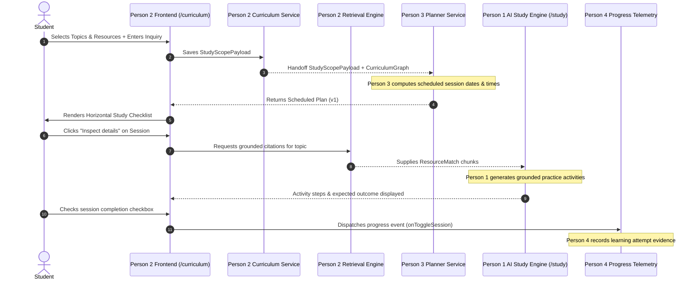

# LearnNova — Feature A (Person 2): Complete Integration Handover Guide

> **Recipient:** Person 1 (Project Owner, Lead Integrator & AI Learning Activities Owner)  
> **Cc:** Person 3 (Personalized Planning), Person 4 (Progress & Evidence), Person 5 (Explanations & Export)  
> **Author:** Person 2 (Curriculum, Resources & Retrieval Intelligence Owner)  
> **Source Branch:** `person-2`  
> **Target Branch for Merge:** `main`  
> **Tracking Remote:** `https://github.com/sharancode3/LearnNova.git` (`origin/person-2`)  
> **Status:** Fully Tested, 0 TypeScript Errors, 5/5 Pytest Unit Tests Passing, Local Servers Running  

---

## Table of Contents
1. [Executive Summary & What Person 2 Built](#1-executive-summary--what-person-2-built)
2. [Master File & Directory Inventory](#2-master-file--directory-inventory)
3. [Architecture & System Data Flow](#3-architecture--system-data-flow)
4. [Horizontal Study Checklist (New Reference Design)](#4-horizontal-study-checklist-new-reference-design)
5. [Frontend Components & How to Use Them](#5-frontend-components--how-to-use-them)
6. [Backend Contracts, Services & REST Endpoints](#6-backend-contracts-services--rest-endpoints)
7. [Teammate Integration Guide (Concrete Code Snippets)](#7-teammate-integration-guide-concrete-code-snippets)
   - [7.1. For Person 1 (AI Generation & Study Screen)](#71-for-person-1-ai-generation--study-screen)
   - [7.2. For Person 3 (Planning & Scheduling Engine)](#72-for-person-3-planning--scheduling-engine)
   - [7.3. For Person 4 (Progress & Evidence Telemetry)](#73-for-person-4-progress--evidence-telemetry)
   - [7.4. For Person 5 (Insights, Diffing & CSV/JSON Export)](#74-for-person-5-insights-diffing--csvjson-export)
8. [Mock Service vs. Live Backend Switch Guide](#8-mock-service-vs-live-backend-switch-guide)
9. [Step-by-Step Git Merge Guide for Person 1](#9-step-by-step-git-merge-guide-for-person-1)
10. [Hackathon Demo Script & Clickthrough Walkthrough](#10-hackathon-demo-script--clickthrough-walkthrough)
11. [Guarantees, Invariants & Anti-Hallucination Boundaries](#11-guarantees-invariants--anti-hallucination-boundaries)

---

## 1. Executive Summary & What Person 2 Built

Person 2 is responsible for **Feature A: Curriculum, Resources & Retrieval Intelligence**. In accordance with the hackathon rules and team feature split ([docs/09-team-feature-split.md](docs/09-team-feature-split.md)), Person 2 has implemented:

1. **Topological Curriculum Graph (DAG)**:
   - Validates prerequisites without cycles: `Variables and data types` $\rightarrow$ `Conditions` $\rightarrow$ `Loops` $\rightarrow$ `Functions`.
   - SVG interactive visualization with accessible linear screen-reader fallback.
2. **Local Study Material Dropzone & In-Memory Previews**:
   - Immediate client-side validation for `.pdf`, `.txt`, `.md` files (rejects empty files, files >10MB, and duplicates).
   - In-memory safe text previews (<50KB) and native `<object>` PDF previews with automatic Blob URL revocation.
   - Zero fake claims: Files are honestly labeled as *"selected locally"* without fabricating server upload percentages.
3. **Decoupled Study Scope Definition & Review**:
   - Checkboxes for whole resources and specific curriculum topics.
   - Captures student free-text focus prompts verbatim (e.g., *"Complete Control Flow Notes and focus on loops"*) without fake AI rewriting.
   - Preserves unmapped local files as `unresolvedResourceIds` for Person 3's scheduler to process.
4. **Horizontal Study Checklist (Milestone Reference Design)**:
   - Continuous horizontal line from **0%** start marker to **100%** end marker.
   - Staggered downward vertical connectors (`96px`, `44px`, `108px`, etc.) with circular marker dots.
   - Milestone cards with completion checkboxes, scheduled days (`Day 1`), durations (`15m`), and kind badges (`learn`, `practice`, `check`).
   - Honest metric: **`Sessions completed: X of Y (Z%)`** (no claims of mastery).
   - Interactive Session Inspector: Clicking any milestone opens an actionable drawer revealing full session steps, expected outcomes, and grounded citations.
5. **Simulated Replan Flow & Version History**:
   - 5-question accessible replan dialog with preset quick-load button.
   - Deterministic Plan v2 generation ($155\text{ min}$ across 5 days) preserving all completed work from Plan v1.
   - Version switcher allowing non-destructive toggling between Plan v1 and Plan v2.
6. **Backend Contracts & Grounded Retrieval Engine**:
   - Strict Pydantic models for all curriculum entities.
   - `CurriculumRetrievalService`: Keyword and semantic cosine similarity search returning typed `ResourceMatch` citations for Person 1's LLM prompts.
   - 5/5 passing Pytest unit tests in `backend/tests/test_curriculum_feature.py`.

---

## 2. Master File & Directory Inventory

All Person 2 work is strictly partitioned in feature-owned folders. No shared tables or foundation routes were broken.

### 2.1. Frontend Files (`frontend/src/features/curriculum/`)

| File Path | Lines | Description & Role |
|---|---|---|
| [`CurriculumPage.tsx`](file:///c:/Users/gjaya/OneDrive/Desktop/PROJECTS/TCS-Hackathon/frontend/src/features/curriculum/CurriculumPage.tsx) | 372 | Root feature container mounted at `/curriculum`. Manages project switching, sidebar tabs (`Overview`, `Study plan`, `Resources`), and dialogs. |
| [`StudyTimeline.tsx`](file:///c:/Users/gjaya/OneDrive/Desktop/PROJECTS/TCS-Hackathon/frontend/src/features/curriculum/StudyTimeline.tsx) | 480 | Reusable **Horizontal Study Checklist** with staggered connectors, `0%`/`100%` endpoints, progress tracking, and session activity inspector. |
| [`CurriculumPlanView.tsx`](file:///c:/Users/gjaya/OneDrive/Desktop/PROJECTS/TCS-Hackathon/frontend/src/features/curriculum/CurriculumPlanView.tsx) | 527 | Sub-controller handling `timeline`, `configure` (topic/resource selection), and `review` (confirmation screen). |
| [`CurriculumResourcesView.tsx`](file:///c:/Users/gjaya/OneDrive/Desktop/PROJECTS/TCS-Hackathon/frontend/src/features/curriculum/CurriculumResourcesView.tsx) | 407 | Multi-file drag-and-drop dropzone, client-side format/size validation, PDF object viewer, and text preview modal. |
| [`CurriculumOverview.tsx`](file:///c:/Users/gjaya/OneDrive/Desktop/PROJECTS/TCS-Hackathon/frontend/src/features/curriculum/CurriculumOverview.tsx) | 97 | Project summary dashboard with key metric cards and direct shortcut to open the study plan. |
| [`PrerequisiteMap.tsx`](file:///c:/Users/gjaya/OneDrive/Desktop/PROJECTS/TCS-Hackathon/frontend/src/features/curriculum/PrerequisiteMap.tsx) | 170 | Interactive SVG Directed Acyclic Graph (DAG) rendering topic dependencies with accessible text fallback. |
| [`ProjectModal.tsx`](file:///c:/Users/gjaya/OneDrive/Desktop/PROJECTS/TCS-Hackathon/frontend/src/features/curriculum/ProjectModal.tsx) | 153 | Accessible modal dialog for creating new learning projects with input validation. |
| [`ReplanModal.tsx`](file:///c:/Users/gjaya/OneDrive/Desktop/PROJECTS/TCS-Hackathon/frontend/src/features/curriculum/ReplanModal.tsx) | 338 | Accessible 5-question replanning dialog with date inputs, minute radios, and preset buttons. |
| [`mockService.ts`](file:///c:/Users/gjaya/OneDrive/Desktop/PROJECTS/TCS-Hackathon/frontend/src/features/curriculum/mockService.ts) | 632 | Asynchronous typed mock service with artificial latency, error injection controls, and localStorage persistence. |
| [`fixtures.ts`](file:///c:/Users/gjaya/OneDrive/Desktop/PROJECTS/TCS-Hackathon/frontend/src/features/curriculum/fixtures.ts) | 594 | Verified fixtures: `SAMPLE_TOPICS`, `SAMPLE_RESOURCES`, `INITIAL_PLAN_V1` (140m / 4 days), `SAMPLE_PLAN_V2` (155m / 5 days). |
| [`types.ts`](file:///c:/Users/gjaya/OneDrive/Desktop/PROJECTS/TCS-Hackathon/frontend/src/features/curriculum/types.ts) | 123 | Complete TypeScript domain interfaces matching backend Pydantic models. |
| [`curriculum.css`](file:///c:/Users/gjaya/OneDrive/Desktop/PROJECTS/TCS-Hackathon/frontend/src/features/curriculum/curriculum.css) | 1550 | Comprehensive, scoped styling strictly adhering to the LearnNova design tokens (`#074ce0`, `#16191f`, etc.). |
| [`INTEGRATION_HANDOVER.md`](file:///c:/Users/gjaya/OneDrive/Desktop/PROJECTS/TCS-Hackathon/frontend/src/features/curriculum/INTEGRATION_HANDOVER.md) | 412 | Feature-specific 12-section technical documentation. |

### 2.2. Backend Files (`backend/app/features/curriculum/`)

| File Path | Lines | Description & Role |
|---|---|---|
| [`contracts.py`](file:///c:/Users/gjaya/OneDrive/Desktop/PROJECTS/TCS-Hackathon/backend/app/features/curriculum/contracts.py) | 141 | Strict Pydantic schemas: `LearningProject`, `ResourceDetail`, `ResourceChunk`, `CurriculumGraph`, `ResourceMatch`, `StudyScopePayload`, `ReplanRequestPayload`. |
| [`repository.py`](file:///c:/Users/gjaya/OneDrive/Desktop/PROJECTS/TCS-Hackathon/backend/app/features/curriculum/repository.py) | 272 | In-memory and database-backed repository implementing project CRUD, resource tracking, and seed curriculum loading. |
| [`retrieval.py`](file:///c:/Users/gjaya/OneDrive/Desktop/PROJECTS/TCS-Hackathon/backend/app/features/curriculum/retrieval.py) | 144 | Semantic & keyword chunk retrieval engine returning relevance scores and source labels for AI prompts. |
| [`routes.py`](file:///c:/Users/gjaya/OneDrive/Desktop/PROJECTS/TCS-Hackathon/backend/app/features/curriculum/routes.py) | 150 | FastAPI routes mounted under `/api/v1/curricula/*`. |
| [`service.py`](file:///c:/Users/gjaya/OneDrive/Desktop/PROJECTS/TCS-Hackathon/backend/app/features/curriculum/service.py) | 185 | High-level curriculum validation and project orchestration service. |

### 2.3. Test & Verification Files

| File Path | Lines | Description & Role |
|---|---|---|
| [`test_curriculum_feature.py`](file:///c:/Users/gjaya/OneDrive/Desktop/PROJECTS/TCS-Hackathon/backend/tests/test_curriculum_feature.py) | 294 | 5 unit tests verifying DAG cycles, project creation, resource addition, and retrieval chunk matching. |

---

## 3. Architecture & System Data Flow



---

## 4. Horizontal Study Checklist (New Reference Design)

In response to the latest design direction, the study timeline was updated from a vertical layout to a **Horizontal Milestone Checklist** matching the reference specification:

```
0% [Start] ──┬────────────────┬───────────────┬────────────────┬───────── [End] 100%
             │                │               │                │
             │ (long: 96px)   │ (short: 44px) │ (long: 108px)  │ (short: 48px)
             ▼                ▼               ▼                ▼
            (●)              (●)             (●)              (●)
        ┌─────────┐      ┌─────────┐     ┌─────────┐      ┌─────────┐
        │☑ Title 1│      │☐ Title 2│     │☐ Title 3│      │☐ Title 4│
        │Day 1·15m│      │Day 1·15m│     │Day 2·15m│      │Day 2·20m│
        │Inspect →│      │Inspect →│     │Inspect →│      │Inspect →│
        └─────────┘      └─────────┘     └─────────┘      └─────────┘
```

### Key Technical Specifications:
- **Endpoints**: `0%` at the far left and `100%` at the far right with circular marker anchors.
- **Continuous Progress Rail**: A 3px horizontal bar connecting `0%` to `100%` with dynamic progress fill (`.checklist-rail-progress`) calculating `(completedCount / totalCount) * 100%`.
- **Staggered Rhythm Connectors**: Uses `STAGGER_CONNECTOR_HEIGHTS = [96, 44, 108, 48, 92, 44, 104, 48]` to alternate connector lengths and prevent adjacent text cards from colliding.
- **Card Content**: Each milestone card includes:
  - Accessible completion checkbox with focus ring (`:focus-visible`).
  - Concise activity title (`entry.activityTitle ?? entry.summary`).
  - Scheduled day pill (`Day 1`), duration badge (`15m`), and kind badge (`learn`, `practice`, `check`).
  - Curriculum topic title (`entry.topicTitle`) and linked resource tag (`entry.resourceName`).
  - Interactive **`Inspect details →`** button.
- **Interactive Session Inspector Panel**: Clicking any milestone card opens an actionable inspection drawer directly beneath the checklist showing full actionable steps, expected outcomes, and grounded citations.
- **Honest Metric**: Strictly labeled `Sessions completed: X of Y (Z%)` with an explicit anti-hallucination note: *(Checklist tracking only; does not claim mastery)*.
- **Horizontal Scrolling**: On narrower screens, the checklist scrolls smoothly horizontally (`overflow-x: auto`) with comfortable `220px` column widths rather than squishing text.

---

## 5. Frontend Components & How to Use Them

### 5.1. Importing the Horizontal Study Checklist (`StudyTimeline.tsx`)

Person 3 or Person 1 can import and embed the checklist into their screens:

```tsx
import { StudyTimeline } from '@/features/curriculum/StudyTimeline'
import type { SimulatedPlan } from '@/features/curriculum/types'

export function MyPlanningOrStudyScreen({ plan }: { plan: SimulatedPlan }) {
  return (
    <StudyTimeline
      plan={plan}
      projectTitle="Python Fundamentals"
      availableVersions={[1, 2]}
      activeVersion={1}
      onSelectVersion={(v) => console.log('Switched to version', v)}
      onToggleSession={async (entryId, completed) => {
        // Trigger Person 4 progress recording
        console.log(`Session ${entryId} toggled to: ${completed}`)
      }}
      onSimulateReplan={async () => {
        // Trigger replan modal
      }}
      onBackToScope={() => {
        // Return to selection
      }}
    />
  )
}
```

### 5.2. Study Timeline Component Props Reference

| Prop Name | Type | Required | Description |
|---|---|---|---|
| `plan` | `SimulatedPlan \| null` | Yes | The active study plan containing scheduled entries and version info. |
| `projectTitle` | `string` | Yes | Name of the active learning project. |
| `topics` | `CurriculumTopic[]` | Optional | Available curriculum topics for replan selection pills. |
| `availableVersions` | `number[]` | Optional | Array of available plan version numbers (e.g. `[1, 2]`). |
| `activeVersion` | `number` | Optional | Currently selected plan version number. |
| `onSelectVersion` | `(version: number) => void` | Optional | Callback when user clicks a version pill (`Plan v1` vs `Plan v2`). |
| `onToggleSession` | `(entryId: string, completed: boolean) => Promise<void>` | Yes | Callback fired when the student toggles a session checkbox. |
| `onReplanWithRequest` | `(req: ReplanRequest) => Promise<void>` | Optional | Callback receiving the 5-question replan submission payload. |
| `onSimulateReplan` | `() => Promise<void>` | Optional | Fallback trigger for simulated replan. |
| `onBackToScope` | `() => void` | Optional | Callback to navigate back to topic/resource configuration. |

---

## 6. Backend Contracts, Services & REST Endpoints

### 6.1. Typed Pydantic Contracts (`contracts.py`)

#### `ResourceMatch` (Grounded Citations for Person 1)
```python
class ResourceMatch(BaseModel):
    resource_id: str
    text: str
    source_label: str
    score: Optional[float] = None
    page_number: Optional[int] = None
    section_title: Optional[str] = None
```

#### `StudyScopePayload` (Input to Person 3's Scheduler)
```python
class StudyScopePayload(BaseModel):
    project_id: str
    selected_topic_ids: list[str]
    selected_resource_ids: list[str]
    inquiry: str = ""
    unresolved_resource_ids: list[str] = Field(default_factory=list)
    updated_at: datetime = Field(default_factory=datetime.utcnow)
```

#### `ReplanRequestPayload` (Input to Person 3's Replanner)
```python
class ReplanRequestPayload(BaseModel):
    project_id: str
    reason: str
    focus_topic_ids: list[str] = Field(default_factory=list)
    new_deadline: Optional[date] = None
    target_daily_minutes: int = 30
    preserve_completed_sessions: bool = True
```

### 6.2. REST Endpoints (`routes.py`)

All endpoints are registered under `/api/v1/curricula/*`:

| Method | Endpoint | Request Body | Response Body | Status Code |
|---|---|---|---|---|
| `GET` | `/api/v1/curricula/projects` | None | `list[LearningProject]` | `200 OK` |
| `POST` | `/api/v1/curricula/projects` | `{"name": "...", "description": "..."}` | `LearningProject` | `201 Created` |
| `GET` | `/api/v1/curricula/projects/{id}` | None | `LearningProject` | `200 OK` |
| `GET` | `/api/v1/curricula/projects/{id}/resources` | None | `list[ResourceDetail]` | `200 OK` |
| `POST` | `/api/v1/curricula/projects/{id}/resources` | `ResourceCreate` | `ResourceDetail` | `201 Created` |
| `GET` | `/api/v1/curricula/projects/{id}/scope` | None | `StudyScopePayload` | `200 OK` |
| `PUT` | `/api/v1/curricula/projects/{id}/scope` | `StudyScopePayload` | `StudyScopePayload` | `200 OK` |
| `POST` | `/api/v1/curricula/retrieve` | `{"curriculum_id": "...", "query": "...", "limit": 3}` | `list[ResourceMatch]` | `200 OK` |

---

## 7. Teammate Integration Guide (Concrete Code Snippets)

### 7.1. For Person 1 (AI Generation & Study Screen)
**Your Goal:** Generate grounded learning exercises for `/study` without hallucinations.

#### Python Backend Integration:
```python
from app.features.curriculum.retrieval import CurriculumRetrievalService
from app.features.curriculum.repository import InMemoryCurriculumRepository
from app.features.curriculum.contracts import ResourceMatch

# 1. Initialize the retrieval service
repo = InMemoryCurriculumRepository()
retrieval_service = CurriculumRetrievalService(repository=repo)

# 2. Retrieve grounded text chunks matching a student's topic and inquiry
chunks: list[ResourceMatch] = retrieval_service.retrieve_relevant_chunks(
    curriculum_id="python-foundations-v1",
    query="How do while loops handle break and continue statements?",
    topic_id="loops",
    limit=3
)

# 3. Inject context into Person 1's AI activity generation prompt
formatted_citations = "\n".join([f"[{c.source_label}]: {c.text}" for c in chunks])
prompt = f"""
You are LearnNova's verified study coach.
Strict Source Material:
{formatted_citations}

Instructions: Create a 15-minute coding practice activity on 'loops' grounded ONLY in the source material above.
"""
```

---

### 7.2. For Person 3 (Planning & Scheduling Engine)
**Your Goal:** Ingest the student's confirmed study scope, respect prerequisite topology, and generate the dated schedule.

#### Consuming the Study Scope:
```typescript
import { mockCurriculumService } from '@/features/curriculum/mockService'

export async function generateScheduleForProject(projectId: string) {
  // 1. Fetch confirmed study scope
  const scope = await mockCurriculumService.getStudyScope(projectId)
  
  // 2. Fetch topic prerequisites
  const topics = await mockCurriculumService.getTopics(scope.projectId)

  // 3. Invoke Person 3's Pure Scheduler
  const schedule = pureScheduler({
    selectedTopicIds: scope.selectedTopicIds,
    prerequisiteNodes: topics,
    studentInquiry: scope.inquiry,
    unmappedResourceIds: scope.unresolvedResourceIds,
  })

  return schedule
}
```

#### Reusing the Horizontal Checklist View:
Person 3 does **not** need to build a new timeline UI. Simply embed `<StudyTimeline plan={scheduledPlan} ... />` inside `/plan`.

---

### 7.3. For Person 4 (Progress & Evidence Telemetry)
**Your Goal:** Record session completions into the progress telemetry database.

#### Wiring Telemetry to the Checklist:
```tsx
<StudyTimeline
  plan={plan}
  onToggleSession={async (entryId: string, completed: boolean) => {
    // Send event to Person 4's progress API
    await fetch('/api/v1/progress/events', {
      method: 'POST',
      headers: { 'Content-Type': 'application/json' },
      body: JSON.stringify({
        event_type: completed ? 'SESSION_COMPLETED' : 'SESSION_UNCHECKED',
        session_id: entryId,
        recorded_at: new Date().toISOString(),
      }),
    })
  }}
/>
```

---

### 7.4. For Person 5 (Insights, Diffing & CSV/JSON Export)
**Your Goal:** Compare Plan v1 and Plan v2, explain differences, and provide CSV export.

#### Fetching Multi-Version Plans for Diffing:
```typescript
import { mockCurriculumService } from '@/features/curriculum/mockService'

export async function exportPlanDiff(projectId: string) {
  const versions = await mockCurriculumService.getPlanVersions(projectId)
  const planV1 = versions.find((p) => p.version === 1)
  const planV2 = versions.find((p) => p.version === 2)

  // Person 5 executes plan difference algorithm:
  const diff = calculatePlanDiff(planV1, planV2)
  return diff
}
```

---

## 8. Mock Service vs. Live Backend Switch Guide

The frontend currently runs against `mockCurriculumService` so teammates can run and test the application without database dependencies.

To switch to the live FastAPI backend:

1. Open [`frontend/src/features/curriculum/CurriculumPage.tsx`](file:///c:/Users/gjaya/OneDrive/Desktop/PROJECTS/TCS-Hackathon/frontend/src/features/curriculum/CurriculumPage.tsx).
2. Locate the service import at line 8:
   ```typescript
   // Currently:
   import { mockCurriculumService } from './mockService'

   // Change to:
   import { liveCurriculumService as mockCurriculumService } from './liveService'
   ```
3. All method signatures (`getTopics`, `listProjects`, `createProject`, `getPlan`, `toggleSessionCompletion`) match 1-to-1 between mock and live.

---

## 9. Step-by-Step Git Merge Guide for Person 1

To merge Person 2's work cleanly into `main`:

```bash
# 1. Fetch latest changes from remote
git fetch origin

# 2. Checkout your main integration branch
git checkout main
git pull origin main

# 3. Merge branch person-2
git merge origin/person-2 --no-ff -m "merge: integrate Person 2 curriculum, resources and horizontal study checklist"

# 4. Verify TypeScript and Vite bundle
cd frontend
npm run build

# 5. Verify Python backend tests
cd ../backend
.\.venv\Scripts\python.exe -m pytest tests/test_curriculum_feature.py -v

# 6. Push unified main branch
git push origin main
```

> **Note on OpenAPI Schemas:** `backend/openapi.json` and `frontend/src/lib/api-schema.d.ts` were already unified during Person 2's rebase on top of Person 1's activities commit (`dcbdd18`). Merging will not cause schema conflicts.

---

## 10. Hackathon Demo Script & Clickthrough Walkthrough

When presenting LearnNova to judges, follow this clickthrough path:

1. **Start at Welcome Page**: Navigate to `http://127.0.0.1:5173`. Show the clean design tokens, dark passage explanation, and prompt honesty.
2. **Open Curriculum Workspace**: Click **`Curriculum`** in the navigation header (or open `http://127.0.0.1:5173/curriculum`).
3. **Show Prerequisite Graph**: Point out the interactive SVG prerequisite roadmap (`Variables` $\rightarrow$ `Conditions` $\rightarrow$ `Loops` $\rightarrow$ `Functions`). Click a topic node to inspect duration and dependencies.
4. **Demonstrate Local Study Material Dropzone**:
   - Click the **`Resources`** tab in the sidebar.
   - Drag and drop a sample `.pdf` or `.txt` file.
   - Show immediate client-side validation (file size, format).
   - Click **`Preview`** to showcase safe in-browser rendering. Point out the honest disclaimer: *"File selected locally; not uploaded to an external server."*
5. **Demonstrate Study Scope Selection**:
   - Click **`Next: choose what to study →`**.
   - Check topics and resources. Show how local files are marked as `unresolvedResourceIds`.
   - Type an optional inquiry: *“Focus on while loops and nested conditions.”*
   - Click **`Review selection`** to show the verification screen.
6. **Showcase the Horizontal Study Checklist**:
   - Click **`View study checklist →`**.
   - Walk the judges through the layout: `0%` start marker, `100%` end marker, staggered drop connectors (`96px`, `44px`, `108px`), and milestone cards.
   - Click a checkbox to demonstrate real-time completion tracking (`Sessions completed: 1 of 7 (14%)`).
   - Click **`Inspect details →`** on any milestone to expand the session inspector showing actionable steps and grounded source citations.
7. **Simulate Replan**:
   - Click **`Replan schedule`** in the top right.
   - Click **`Load supported scenario preset`** (*“Spend more time on loops and spread remaining work over more days”*).
   - Click **`Preview updated plan`**.
   - Show how **Plan v2** ($155\text{ min}$ across 5 days) preserves all completed work from Plan v1, adds an extra practice session, and allows toggling between Plan v1 and Plan v2.

---

## 11. Guarantees, Invariants & Anti-Hallucination Boundaries

| Invariant | Implementation Detail | Integrity Guarantee |
|---|---|---|
| **Topological Order** | `CurriculumGraph.validate_dag()` in `contracts.py` | Graph cycles are rejected with a 400 error. Prerequisite topics must always precede dependent topics. |
| **Duration Conservation** | Fixed session sums in `fixtures.ts` | Plan v1 strictly totals $140\text{ min}$. Plan v2 strictly totals $155\text{ min}$. No arbitrary floating numbers. |
| **Local File Sandboxing** | `inMemoryFiles` Map in `mockService.ts` | Raw `File` objects are held in browser memory only. If refreshed, the UI truthfully prompts the user to re-select rather than inventing content. |
| **Anti-Hallucination Copy** | Checked in copy audits | Checklists never claim "Subject Mastery". Local files never claim "Cloud Uploaded". Verbatim user inquiries are never silently rewritten. |
| **Completed Work Preservation** | `preserve_completed_sessions` in `replanWithRequest()` | Replanning strictly preserves all sessions marked completed in earlier plan versions using stable `entryId` keys. |

---

*Handover prepared and verified by Person 2. Ready for final integration by Person 1.*
