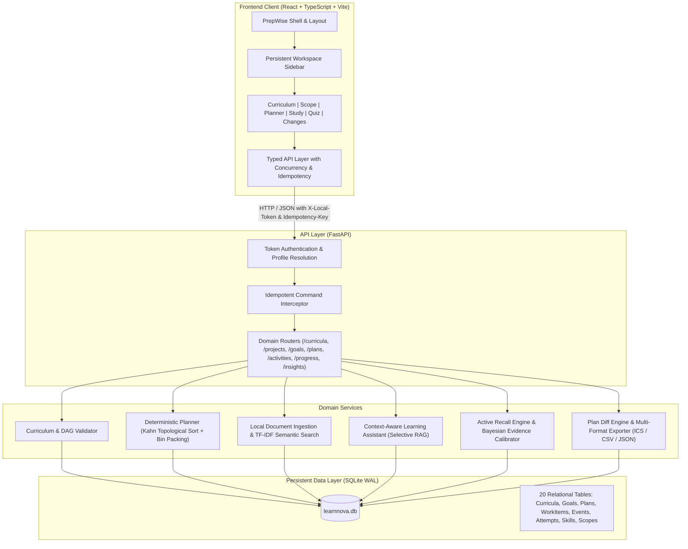
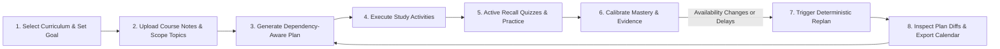
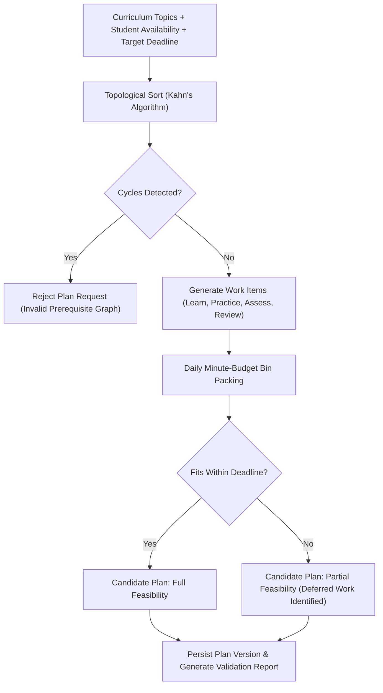
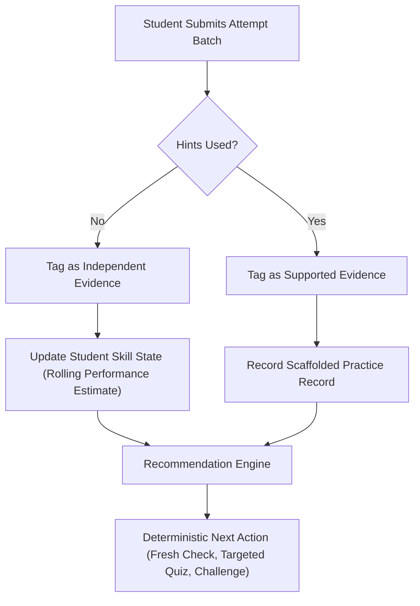

# PrepWise

PrepWise is a curriculum-grounded personalized study planning and adaptive learning platform. It transforms course materials, target dates, and daily time constraints into deterministic, dependency-aware study schedules, integrated active recall practice, contextual AI tutoring, and actionable version comparison.

---

## Executive Summary

Students frequently struggle with transforming static syllabi and unstructured course notes into realistic daily study habits. Existing planning tools either treat study items as disconnected to-do lists without prerequisite awareness or rely on unconstrained generative AI models that hallucinate study timetables, miss deadlines, and ignore time availability.

PrepWise addresses these deficiencies through a deterministic planning engine backed by a Directed Acyclic Graph (DAG) curriculum model, semantic document retrieval, evidence-based performance tracking, and an interactive study execution workspace. Every generated plan respects prerequisite orderings, daily time budgets, and verified learning states without relying on synthetic mocks in production code paths.

---

## System Architecture

The PrepWise architecture decouples deterministic scheduling and domain state from the local AI assistant and retrieval pipeline. The backend is built on FastAPI and SQLite with Write-Ahead Logging (WAL), utilizing SQLAlchemy ORM models, Alembic migrations, and Pydantic validation contracts. The frontend is a responsive Single Page Application (SPA) built with React, TypeScript, and Vite, driven by a tokenized design system.



---

## End-to-End Student Journey

The platform guides a student through a continuous loop of planning, execution, assessment, and dynamic replanning.



---

## Core Subsystems

### 1. Curriculum and Prerequisite Modeling

Curricula are defined as directed graphs where nodes represent topics and skills, and directed edges represent prerequisite dependencies.

- Graph Validation: The curriculum service ensures that all topic prerequisites form a valid Directed Acyclic Graph (DAG) using Kahn's algorithm. Cyclic relationships are caught and rejected during ingestion.
- Granular Micro-Skills: Each topic encapsulates specific micro-skills (for example, the Loops topic contains Range Endpoints and Accumulator Updates). Micro-skills anchor quiz questions, learning activities, and mastery tracking.
- Study Scopes: Students can customize which curriculum topics are included in their project scope, specifying target mastery thresholds and focus areas.

### 2. Deterministic Adaptive Planner

The planning engine converts curriculum requirements, target deadlines, and variable daily study time availability into an actionable study timetable.

- Prerequisite Resolution: Topics are sequenced topologically so prerequisite concepts are scheduled prior to advanced topics.
- Work Item Generation: Standardized study units (`learn`, `practice`, `assess`, `review`) are created with calibrated durations based on topic complexity.
- Daily Budget Bin-Packing: The scheduler iterates through available dates, filling each day's study budget without exceeding the student's declared availability.
- Feasibility Analysis: If the total required study time exceeds available time before the deadline, the planner flags the schedule as partially feasible or infeasible, identifies deferred items, and provides transparent explanations.
- Dynamic Replanning: When study availability shifts or sessions are missed, the replanner constructs a new plan revision, links it to its parent version, and attributes every added, removed, or rescheduled item.



### 3. Scoped Retrieval and Context-Aware AI Assistant

PrepWise includes a selective Retrieval-Augmented Generation (RAG) assistant designed specifically for learning support.

- Document Ingestion: Supports PDF and Markdown course material uploads. Documents can be linked directly to specific topics or left unmapped for global course context.
- Selective Semantic Retrieval: Rather than sending unconstrained queries to an LLM, the retrieval engine extracts grounded passages matching the active study topic and current work item.
- Hallucination Control: If a query falls outside the uploaded course materials or curriculum scope, the assistant declines to invent facts, citing the specific missing coverage.
- Structured Learning Activities: For every plan entry, the system generates structured activities including learning objectives, step-by-step guidance, required resources, and verifiable mastery criteria.

### 4. Progress Tracking and Active Recall Engine

The progress engine tracks learning execution and calibrates student mastery without fabricating false estimates.

- Work Item State Machine: Students log planned study sessions as completed or missed, recording actual minutes spent to assess timetable accuracy.
- Question Bank Architecture: Questions are mapped to specific skills, difficulties (1 to 5), and forms (`baseline`, `followup`, `practice`). Draft questions remain excluded until formally reviewed.
- Evidence Classification:
  - Independent Evidence: Quizzes submitted without hints. Directly influences Bayesian mastery estimates.
  - Supported Evidence: Quizzes taken with hints or step-by-step assistance. Categorized as scaffolded practice.
- Nearest-Difficulty Relaxation: When a student exhausts questions at an exact difficulty level, the selector intelligently pulls the nearest unattempted items, preventing unexpected empty question pools.
- Recommendation Service: Generates deterministic next-step recommendations (`fresh_check`, `targeted_quiz`, `challenge_quiz`, `mixed_practice`) based on rolling performance estimates and coverage gaps.



### 5. Plan Comparison, Insights, and Calendar Export

When plans are revised, PrepWise enables side-by-side inspection and external calendar synchronization.

- Version Diffing: Highlights added, removed, shifted, and duration-modified entries between any two plan versions.
- Factual Attribution: Each plan shift is explicitly connected to student actions (for example, logging actual study time or changing daily availability).
- Multi-Format Export:
  - iCalendar (`.ics`): Direct calendar integration for Google Calendar, Apple Calendar, and Microsoft Outlook.
  - CSV Export: Structured timetable entries with date, sequence, topic, activity kind, duration, and instructions.
  - JSON Export: Complete machine-readable plan payload including feasibility metrics and validation reports.

---

## Concurrency and Idempotency Architecture

To ensure data integrity during real-time operations, PrepWise enforces strict distributed systems guarantees:

- Optimistic Concurrency Control: The student profile maintains an integer `input_revision` counter. Mutating operations (such as plan creation, progress logging, and quiz submissions) require an `expected_revision`. Stale revisions are rejected with HTTP 409 Conflict.
- Idempotency Interceptor: All mutating endpoints require an `Idempotency-Key` header. Duplicate requests return cached receipts, preventing double-submission of quiz answers or redundant schedule generation.
- Atomic Database Operations: All multi-table mutations are wrapped in database transactions with foreign key cascades and SQLite busy timeout protection.

---

## Repository Structure

```
LearnNova/
├── backend/
│   ├── alembic/                      # Database migrations
│   ├── app/
│   │   ├── api/                      # Dependency injection, authentication, idempotency
│   │   ├── cli.py                    # Command-line interface for demo setup and operations
│   │   ├── config.py                 # Application configuration and environment settings
│   │   ├── contracts/                # Strict domain contracts and Pydantic models
│   │   ├── core/                     # Logging, error types, security utilities
│   │   ├── db/                       # SQLAlchemy models and SQLite connection lifecycle
│   │   ├── features/
│   │   │   ├── activities/           # AI assistant and structured activity generation
│   │   │   ├── curriculum/           # Curriculum DAG management and project scoping
│   │   │   ├── demo/                 # Synthetic student dataset generator and verification
│   │   │   ├── insights/             # Plan version diffing and calendar/CSV/JSON exports
│   │   │   ├── planning/             # Kahn topological sort and minute-budget planner
│   │   │   └── progress/             # Active recall quiz engine, evidence projection, recommendations
│   │   └── main.py                   # FastAPI application factory and router registration
│   ├── data/                         # SQLite database file (WAL mode)
│   ├── demo_assets/                  # Sample PDF guides and markdown reference documents
│   └── tests/                        # Comprehensive pytest test suite (95 tests)
│
├── frontend/
│   ├── src/
│   │   ├── components/               # Tokenized UI primitives (Button, Panel, Notice, Navigation)
│   │   ├── features/
│   │   │   ├── assistant/            # Contextual learning assistant drawer
│   │   │   ├── curriculum/           # Curriculum graph viewer, SVG prerequisite maps, scope editor
│   │   │   ├── insights/             # Plan comparison views and export controls
│   │   │   ├── planning/             # Plan generation forms, timeline visualizer, job tracker
│   │   │   ├── progress/             # Quiz setup, quiz player, quiz results, mastery dashboard
│   │   │   └── study/                # Interactive study execution and session timer
│   │   ├── lib/                      # API client, token handling, date formatting
│   │   ├── App.tsx                   # Main route configuration and workspace shell
│   │   └── index.css                 # Tokenized design system stylesheet
│   ├── index.html
│   ├── package.json
│   └── vite.config.ts
│
├── demo_outputs/                     # Exported CSV and JSON plan outputs
└── docs/                             # Engineering runbooks, architecture specs, and stage handoffs
```

---

## Synthetic Demo Scenario

The application includes an end-to-end synthetic scenario featuring a student named **Alex Demo Learner** preparing for a **Python Foundations Assessment**.

- Student Identifier: `demo-alex-student`
- Local Access Token: `demo-token-alex-prepwise-2026`
- Curriculum: `python-foundations-v1` (Variables, Expressions, Conditions, Loops, Lists, Functions)
- Ingested Documents:
  - `programming_foundations_course_guide.pdf`: 5-page structured guide mapped to the `loops` topic.
  - `programming_foundations_workbook.pdf`: 4-page practical workbook with unmapped reference exercises.
  - `loops_and_accumulators_quickref.md`: Markdown reference with code snippets and tracing examples.
- Pre-Configured Plans:
  - Plan Version 1: 9 scheduled work items spanning baseline availability.
  - Plan Version 2: Re-planned version demonstrating schedule adjustments after availability changes.
- Assessment State: 46 reviewed questions across difficulties 1 through 5, with initial evidence logged for range endpoints and accumulator updates.

To initialize or reset the demo dataset at any time:

```bash
cd backend
.\.venv\Scripts\python.exe -m app.cli setup-demo
```

To clean and reset the demo environment:

```bash
cd backend
.\.venv\Scripts\python.exe -m app.cli reset-demo
```

---

## Quickstart Guide

### Prerequisites

- Python 3.10 or higher
- Node.js 18 or higher with npm

### 1. Backend Setup

```bash
# Navigate to the backend directory
cd backend

# Create and activate a virtual environment
python -m venv .venv
.\.venv\Scripts\activate   # Windows
# or: source .venv/bin/activate  # macOS / Linux

# Install dependencies
pip install -r requirements.txt

# Run database migrations
alembic upgrade head

# Seed the demo dataset
python -m app.cli setup-demo

# Start the FastAPI server
python -m uvicorn app.main:app --host 127.0.0.1 --port 8000 --reload
```

The backend API will be accessible at `http://127.0.0.1:8000`. Interactive OpenAPI documentation is available at `http://127.0.0.1:8000/docs`.

### 2. Frontend Setup

```bash
# Navigate to the frontend directory
cd frontend

# Install dependencies
npm install

# Start the Vite development server
npm run dev
```

The web client will be accessible at `http://127.0.0.1:5173`.

---

## API Reference Overview

All mutating requests require `X-Local-Token` and `Idempotency-Key` headers.

| Method | Endpoint | Description |
|---|---|---|
| `GET` | `/api/v1/health` | Service health status and database readiness check |
| `GET` | `/api/v1/me` | Fetch authenticated student profile and current revision |
| `GET` | `/api/v1/curricula` | List all available published curricula |
| `GET` | `/api/v1/curricula/{id}` | Retrieve curriculum snapshot with topics and prerequisites |
| `POST` | `/api/v1/projects` | Create a new learning project for a curriculum |
| `POST` | `/api/v1/goals` | Create a study goal with availability and deadline |
| `POST` | `/api/v1/goals/{id}/plan-jobs` | Trigger deterministic plan generation job |
| `GET` | `/api/v1/plan-jobs/{job_id}` | Poll plan job status and result |
| `GET` | `/api/v1/plans/{id}` | Fetch structured candidate plan with metrics |
| `GET` | `/api/v1/plans/{id}/changes` | Diff plan against a base version with change attribution |
| `GET` | `/api/v1/plans/{id}/export` | Export plan to CSV or JSON format |
| `GET` | `/api/v1/plans/{id}/calendar.ics` | Download plan as an iCalendar (.ics) file |
| `POST` | `/api/v1/goals/{id}/progress-events` | Log work item completion or missed session |
| `GET` | `/api/v1/goals/{id}/questions` | Fetch reviewed questions with topic, skill, and difficulty filters |
| `POST` | `/api/v1/goals/{id}/attempt-batches` | Submit quiz answers for server-side scoring and evidence logging |
| `GET` | `/api/v1/goals/{id}/learning-state` | Fetch calibrated per-skill evidence breakdown |
| `GET` | `/api/v1/goals/{id}/recommendation` | Retrieve deterministic next quiz recommendation |
| `GET` | `/api/v1/goals/{id}/dashboard` | Composite dashboard: active plan progress, skills, and recommendations |
| `POST` | `/api/v1/assistant/chat` | Context-aware tutoring query with selective document retrieval |

---

## Verification and Quality Assurance

The codebase is protected by comprehensive test suites across both backend and frontend.

### Backend Test Suite

```bash
cd backend
.\.venv\Scripts\python.exe -m pytest -v
```

Verification Results:
- 95 passed in 18.26s
- 100% test pass rate across planning, progress, retrieval, assistant, and export modules.
- Verification covers:
  - Kahn algorithm topological sorting and prerequisite cycle detection.
  - Bin-packing minute constraints and feasibility flags.
  - Optimistic revision concurrency and idempotency caching.
  - Exclusion of unreviewed question drafts from quiz retrieval.
  - Independent vs. supported evidence calibration and score calculation.
  - Multi-version plan comparisons and RFC-5545 iCalendar compliance.

### Frontend Quality Checks

```bash
cd frontend
npm run build
```

Verification Results:
- TypeScript static analysis passed with zero type errors.
- Vite production bundle generated cleanly without warnings.
- Fully responsive layout verified across desktop, tablet, and mobile breakpoints.

---

## License

This project is licensed under the Apache License 2.0.
